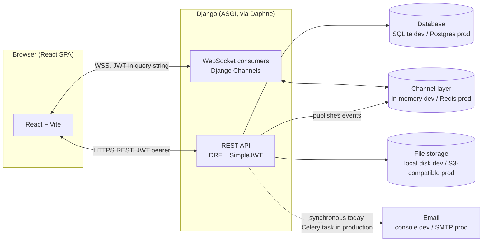
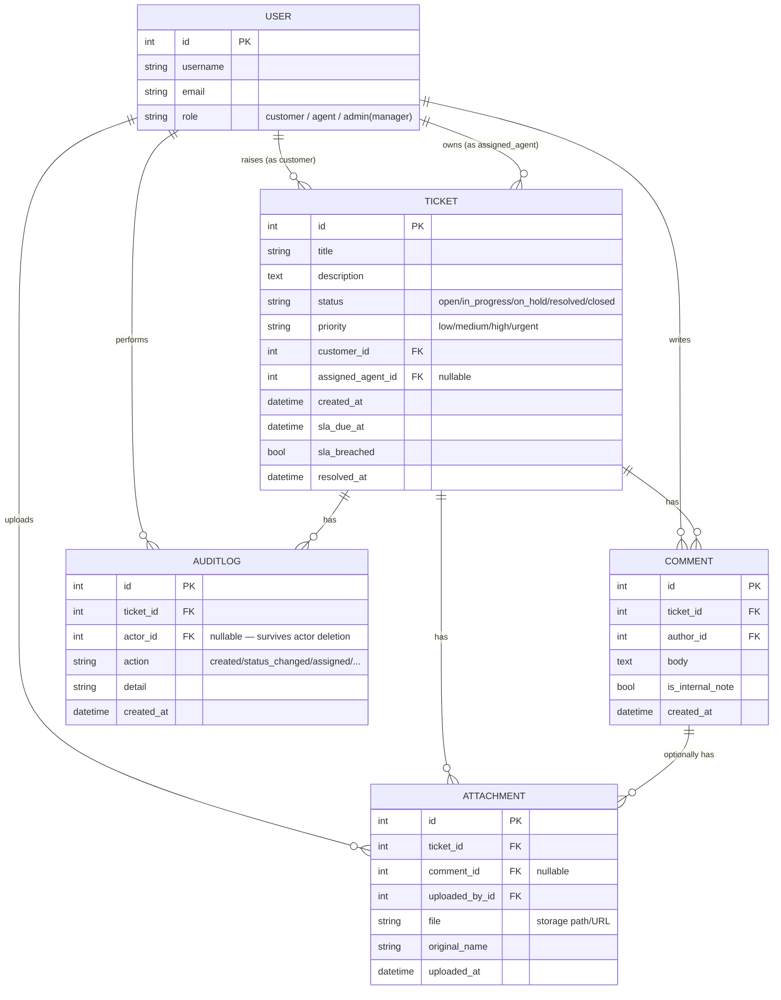
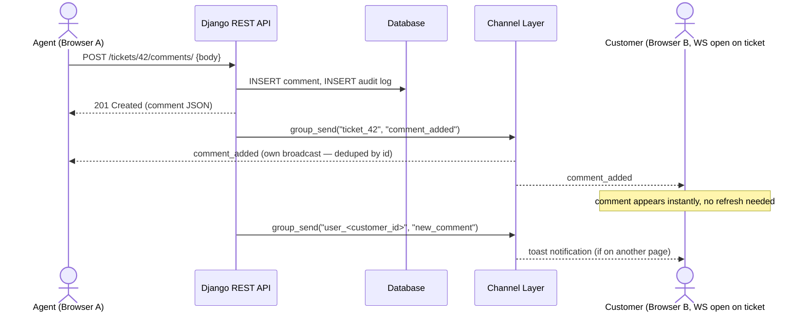
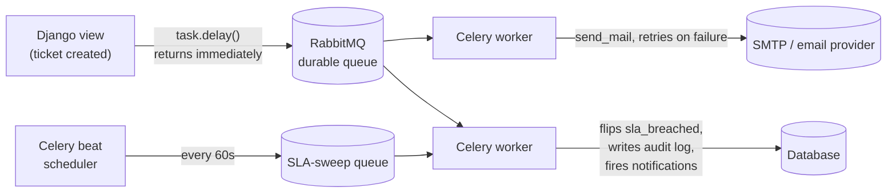
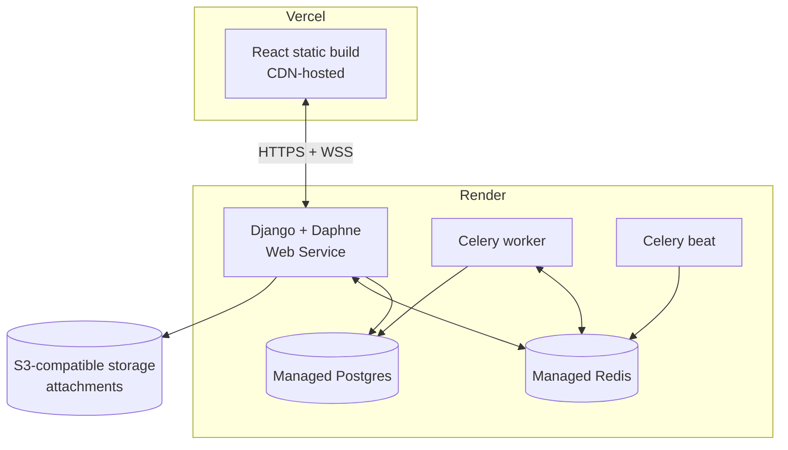

# Real-Time Helpdesk

A lightweight Zendesk/Jira-style helpdesk: customers raise tickets, agents pick them up
and chat with customers in real time, managers oversee assignment and SLA compliance,
and everyone sees live updates without refreshing.

```
Customer → Create Ticket → Support Agent → Assign Ticket → Chat / Comments → Resolve
```

**Backend:** Django + Django REST Framework + Django Channels (WebSockets) + SimpleJWT (JWT auth)
**Frontend:** React (Vite) + React Router + Recharts, talking to the API over REST + native WebSocket

For the full engineering write-up (data flow, concurrency handling, trade-offs), see
**[`ARCHITECTURE.md`](./ARCHITECTURE.md)**. For deploying this to Render/Vercel, see
**[`DEPLOYMENT.md`](./DEPLOYMENT.md)**. For a set of interview-style Q&A grounded in this
project's design decisions, see **[`INTERVIEW_PREP.md`](./INTERVIEW_PREP.md)**.

---

## Contents

- [Architecture at a glance](#architecture-at-a-glance)
- [Features](#features)
- [Data model](#data-model)
- [How real-time updates work](#how-real-time-updates-work)
- [Background jobs — Celery & RabbitMQ](#background-jobs--celery--rabbitmq)
- [SLA checks — what they do and why they matter](#sla-checks--what-they-do-and-why-they-matter)
- [Choosing a database — SQL vs. MongoDB, and where attachments belong](#choosing-a-database--sql-vs-mongodb-and-where-attachments-belong)
- [Project layout](#project-layout)
- [Running it locally](#running-it-locally)
- [Environment variables](#environment-variables)
- [Deploying it (Render + Vercel)](#deploying-it-render--vercel)
- [Roles & permissions](#roles--permissions)
- [Known limitations](#known-limitations--whats-simplified-for-this-demo)

---

## Architecture at a glance



The frontend never talks to the database or the channel layer directly — everything
goes through the Django API, either as a normal request/response or as a WebSocket
event. That single entry point is what makes the permission model (who can see/edit
what) enforceable in one place.

## Features

- **JWT auth** — register/login/refresh, role embedded in the token
- **Roles** — Customer / Agent / Manager ("admin" under the hood), enforced in
  querysets *and* serializers *and* object permissions, not just hidden in the UI:
  - **Manager** can assign, reassign, or unassign any ticket, and edit any ticket
  - **Agent** can self-assign an unassigned ticket, and can only edit a ticket once
    it's assigned to them — never another agent's ticket, never an unassigned one
  - **Customer** can create tickets and comment on their own — no ticket-editing
    rights at all, enforced server-side even if the UI is bypassed
- **Ticket priority** (low/medium/high/urgent) driving a computed **SLA timer** —
  see the [SLA section](#sla-checks--what-they-do-and-why-they-matter) below
- **Comments** — threaded per ticket, plus agent/manager-only **internal notes**
  invisible to the customer
- **File attachments** on tickets
- **WebSocket live updates** — `ws/tickets/<id>/` for a ticket's chat/status/assignment
  feed, `ws/notifications/` for a personal + role-wide toast stream — see
  [How real-time updates work](#how-real-time-updates-work)
- **Email notifications** on ticket creation, assignment, replies, and SLA breaches
- **Search** across title/description/customer + filters for status/priority/assignment/breach
- **Analytics** — explicit counts for every status, average resolution time, SLA
  breach count, 14-day creation trend, and a per-agent "who closed how many tickets" table
- **Audit history** — every status/priority/assignment change, comment, and attachment
  is logged per ticket, with actor and timestamp

## Data model



Why it's shaped this way — one `User` model with a `role` field rather than separate
tables per role, `assigned_agent` using `SET_NULL` (a ticket outlives the agent who
worked it), `sla_due_at` computed once at creation rather than on every read, and
`sla_breached` as a sticky flag rather than a live-computed condition — is all explained
in detail in [`ARCHITECTURE.md` §1](./ARCHITECTURE.md#1-data-model).

## How real-time updates work

Two kinds of WebSocket "rooms" (Channels groups), joined automatically by the frontend:



- **`ticket_<id>`** — everyone currently viewing that ticket's detail page. Carries new
  comments, status/priority changes, assignment changes, attachment uploads, SLA
  breach flips, and typing indicators.
- **`user_<id>`** / **`role_<role>`** — joined once per session regardless of what page
  you're on. Carries personal notifications ("assigned to you") and role-wide ones
  ("a new ticket just came in", broadcast to every connected agent).

Authentication over WebSocket is handled by a custom middleware
(`tickets/middleware.py`), since the browser's native `WebSocket` API can't send a
`Authorization` header on the handshake — the JWT access token is instead passed as
`?token=...` in the connection URL and validated the same way `SimpleJWT` validates
REST requests, before the connection is accepted.

The **channel layer** itself (the pub/sub backbone consumers publish to/subscribe from)
is `InMemoryChannelLayer` in this demo — correct for a single process, but it does
**not** share state across multiple server processes. Full explanation, plus exactly
what breaks and how Redis fixes it, in
[`ARCHITECTURE.md` §2](./ARCHITECTURE.md#2-real-time-communication-websockets).

## Background jobs — Celery & RabbitMQ

**Current state of this codebase:** email sending and SLA-breach detection are
**not** running through Celery/RabbitMQ yet. Email is sent synchronously inline
(console backend), and SLA breaches are checked by a plain management command
(`check_sla_breaches`) meant to be invoked by an external scheduler (cron / Celery
beat / a Kubernetes CronJob) on an interval.

**What Celery + RabbitMQ would actually do here, and why they're two different jobs
from the WebSocket channel layer:**



| | Channel layer (Redis/in-memory) | Celery + broker (RabbitMQ/Redis) |
|---|---|---|
| Purpose | Fan out a live event to whichever sockets are connected *right now* | Durably run a unit of work, with retries, independent of any browser being open |
| Guarantee | Best-effort, at-most-once — if nobody's listening, it's just gone | Durable — survives a worker restart, broker acknowledges/retries |
| Used for | Live comment/status push, typing indicators, toasts | Would be used for: email sending, the periodic SLA sweep, (future) attachment virus scanning |

Concretely, the production version of the "email on ticket assignment" call would go
from this (current, blocking):
```python
send_email_notification(subject, message, recipients)   # runs inline, in the request
```
to this (async, retried, non-blocking):
```python
send_ticket_email.delay(subject, message, recipients)   # enqueued to RabbitMQ, returns instantly
```
where `send_ticket_email` is a `@shared_task` with `max_retries`/backoff, and
`check_sla_breaches` becomes a Celery-beat-scheduled task instead of a cron entry.

Full config/code sketch, and the "why RabbitMQ over just reusing Redis" trade-off
discussion, in [`ARCHITECTURE.md` §4](./ARCHITECTURE.md#4-async-processing-current-implementation-vs-rabbitmq--celery-design).

## SLA checks — what they do and why they matter

**What happens, mechanically:** every ticket gets an `sla_due_at` computed once at
creation from its priority (`SLA_HOURS` in `settings.py` — urgent = 4h, high = 8h,
medium = 24h, low = 72h). A sweep (`check_sla_breaches`) finds tickets past that
deadline that aren't already flagged, sets `sla_breached=True`, writes an audit-log
entry, and fires a notification (WebSocket + email) to the assigned agent. The flag is
**sticky** — resolving a ticket later doesn't retroactively un-breach it, because the
breach already happened as a matter of historical fact.

**Why this matters, beyond "it's a countdown timer":**

- **Predictable service levels** — "urgent" isn't just a label, it's an enforced
  promise the system actively checks, not something that only gets noticed if a
  customer complains.
- **Prioritization signal for agents** — the near-breach/breached badge tells an
  agent what to work on next far better than a plain first-in-first-out queue would.
- **Accountability & performance measurement** — the analytics "who closed how many
  tickets" breakdown, combined with breach data, turns "is our support team meeting
  its commitments" into a queryable fact instead of a gut feeling.
- **Escalation hook** — a breach is a discrete event (not a continuously-reevaluated
  condition), which is exactly the shape you need to hang further automation off of
  later — e.g. auto-escalate to a manager, auto-bump priority, post to a Slack channel.
- **Compliance / contractual reporting** — for support that's contractually bound to
  response-time SLAs, having a timestamped, audit-logged breach history is exactly
  what you'd need to produce for a customer dispute or an internal review.
- **Decoupled from the request path by design** — because the sweep runs
  independently (not inline with every page load), it can be scaled, retried, and
  monitored on its own, the same reasoning that motivates moving it onto Celery beat
  in production (see above).

## Choosing a database — SQL vs. MongoDB, and where attachments belong

**Short version:** this project's data (tickets → comments/attachments/audit logs, all
foreign-keyed, all queried with joins and permission-scoped filters, all requiring
transactional consistency for SLA/audit writes) is a strong fit for a relational
database — SQLite in this dev setup, Postgres recommended for production. A document
database like MongoDB isn't a natural fit for *this* schema without denormalizing it
(e.g. embedding comments inside the ticket document), which trades away exactly the
things this app relies on: atomic per-comment writes, straightforward cross-entity
queries ("all tickets assigned to agent X"), and Django's ORM/migrations/admin tooling.

**If the real goal is "attachments shouldn't just live on local disk"** — which is
usually what people actually mean when this comes up — the right fix isn't switching
databases, it's switching *where file blobs live*: move attachments to S3-compatible
object storage (AWS S3, Cloudflare R2, GCS) via `django-storages`, independent of
whatever database holds the metadata. This is the same fix either way, whether the
core database stays Postgres or becomes MongoDB — file bytes don't belong inside a
database row/document in either world.

**If MongoDB is genuinely wanted as the primary datastore** (e.g. because it's an org
standard, or a specific document-shaped feature emerges later), that's a real, larger
migration — replacing Django's ORM models with `mongoengine`/`pymongo` documents (or
`djongo`, which has had version-compatibility issues historically), denormalizing the
schema, and reimplementing the joins this app currently gets "for free" from Postgres
as explicit application-level lookups or aggregation pipelines. MongoDB's **GridFS**
is the Mongo-native answer specifically for large binary attachments (it chunks files
around MongoDB's 16MB document limit) if you did go that route — but even then, most
teams still end up putting file bytes in object storage and just the metadata in Mongo,
for the same reason Postgres users do.

The full trade-off writeup — including a sketch of what a Mongo-native ticket document
would look like — is in
[`ARCHITECTURE.md` §9](./ARCHITECTURE.md#9-alternative-datastores-mongodb-and-object-storage-for-attachments).

## Project layout

```
backend/    Django project (REST API + WebSocket consumers)
  accounts/   custom User model, JWT auth endpoints
  tickets/    Ticket/Comment/Attachment/AuditLog models, views, consumers, permissions
frontend/   React app (Vite)
  src/api/        axios client + endpoint wrappers
  src/context/    auth + notification (WebSocket) React contexts
  src/hooks/      per-ticket WebSocket hook
  src/pages/      route-level pages (login, ticket list/detail, analytics, ...)
  src/components/ shared UI pieces (navbar, badges, toasts)
ARCHITECTURE.md    deep-dive engineering write-up
DEPLOYMENT.md       Render + Vercel deployment guide
INTERVIEW_PREP.md   Q&A grounded in this project's design decisions
```

## Running it locally

### 1. Backend

```bash
cd backend
python3 -m venv venv && source venv/bin/activate      # optional but recommended
pip install -r requirements.txt

python manage.py migrate
python manage.py seed_demo_data     # creates demo users + sample tickets (optional)
python manage.py runserver 0.0.0.0:8000
```

This starts Daphne (ASGI), serving both the REST API and WebSockets on port 8000.

Demo logins created by `seed_demo_data`:

| Username    | Password     | Role         |
|-------------|--------------|--------------|
| admin       | admin123     | manager      |
| agent1/2/3  | agent123     | agent        |
| customer1-5 | customer123  | customer     |

To check SLA breaches (run this periodically — e.g.
`* * * * * cd backend && python manage.py check_sla_breaches` in cron):

```bash
python manage.py check_sla_breaches
```

### 2. Frontend

```bash
cd frontend
npm install
npm run dev
```

Visit `http://localhost:5173`. It talks to the API at `http://localhost:8000` (see
`frontend/.env` — `VITE_API_URL` / `VITE_WS_URL`).

### 3. Admin panel

Django admin is available at `http://localhost:8000/admin/` (log in as
`admin`/`admin123`) for inspecting/editing raw data.

## Environment variables

| Variable | Where | Default (dev) | Notes |
|---|---|---|---|
| `DJANGO_SECRET_KEY` | backend | insecure dev key | **must** be set to a real secret in production |
| `DJANGO_DEBUG` | backend | `1` | set to `0` in production |
| `FRONTEND_URL` | backend | `http://localhost:5173` | used in outgoing email links |
| `VITE_API_URL` | frontend | `http://localhost:8000/api` | REST base URL |
| `VITE_WS_URL` | frontend | `ws://localhost:8000` | WebSocket base URL (`wss://` in production) |

Production deployments add several more (database URL, Redis URL, email credentials,
allowed hosts/CORS origins) — the full list with example values is in
[`DEPLOYMENT.md`](./DEPLOYMENT.md#environment-variables-reference).

## Deploying it (Render + Vercel)

**Short version:** the React frontend deploys to **Vercel** (or any static host) as a
plain static build. The Django + Channels backend needs a **long-running process**
that can hold WebSocket connections open, which rules out Vercel's serverless function
model — it deploys to **Render** (or Railway/Fly.io/a VPS) instead, alongside managed
Postgres and Redis.



Full step-by-step (Render service setup, Vercel project setup, required settings.py
changes for env-based config, and why Vercel specifically can't host the backend) is
in **[`DEPLOYMENT.md`](./DEPLOYMENT.md)**.

## Roles & permissions

| Role | Create tickets | Comment | Edit any ticket | Self-assign | Assign/reassign/unassign others |
|---|---|---|---|---|---|
| **Customer** | ✅ own tickets | ✅ own tickets | ❌ | ❌ | ❌ |
| **Agent** | ❌ | ✅ tickets assigned to them | only tickets assigned to them | ✅ (unassigned tickets) | ❌ |
| **Manager** (`admin` role) | ✅ | ✅ | ✅ all | n/a | ✅ |

Enforced in three independent layers so a bypassed frontend can't escalate privilege:
queryset scoping (what you can even see), object permissions (what you can write to),
and per-role serializers (agents get a serializer that doesn't expose the
`assigned_agent` field at all, so it's silently ignored even if sent).

## Known limitations / what's simplified for this demo

- Single-process WebSocket layer (in-memory, not Redis) — fine for a demo, not for
  running more than one backend process
- Email/SLA-sweep run synchronously/via cron rather than through Celery/RabbitMQ
- No optimistic-concurrency check on ticket edits (last-write-wins if two people edit
  the same ticket at the same instant)
- No file-type/size validation or malware scanning on attachment uploads
- Attachments served from local disk, not object storage
- Open self-registration for the manager role (no invite-code gating)

Each of these is discussed in depth, with what a production fix looks like, in
[`ARCHITECTURE.md`](./ARCHITECTURE.md).s