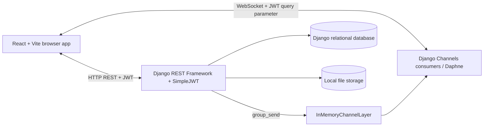
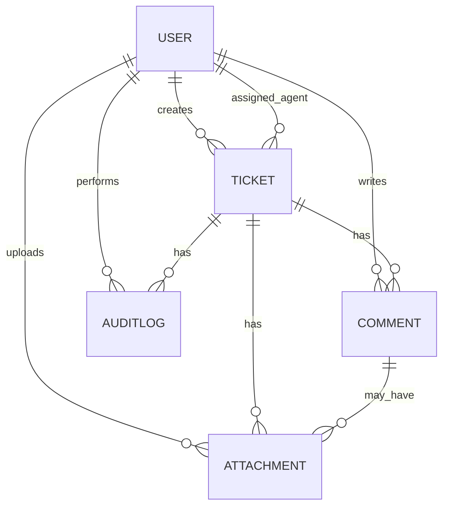
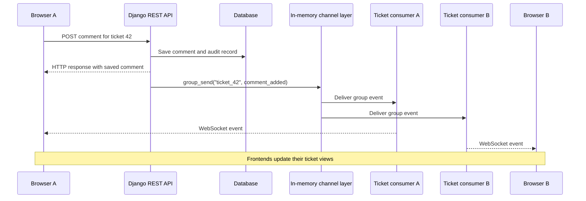
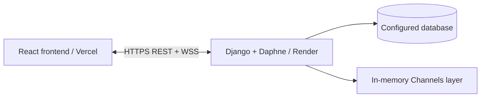

# Real-Time Helpdesk

A Django and React helpdesk application where customers create support tickets, agents manage assigned tickets, and managers oversee ticket activity. Ticket comments and changes are pushed to connected users through WebSockets without requiring a page refresh.

```text
Customer creates ticket → Agent self-assigns / Manager assigns → Comments and updates → Resolution
```

**Backend:** Django, Django REST Framework, Django Channels, Daphne (ASGI), SimpleJWT  
**Frontend:** React (Vite), React Router, Recharts, Axios, native WebSocket API


## Contents

- [Implemented architecture](#implemented-architecture)
- [Implemented features](#implemented-features)
- [Data model](#data-model)
- [How real-time updates work](#how-real-time-updates-work)
- [SLA functionality](#sla-functionality)
- [Project layout](#project-layout)
- [Running locally](#running-locally)
- [Configuration](#configuration)
- [Deployment](#deployment)
- [Roles and permissions](#roles-and-permissions)
- [Not integrated / current limitations](#not-integrated--current-limitations)

## Implemented architecture



The frontend uses REST endpoints to read and persist ticket data. Django Channels provides live events over separate WebSocket connections. The current channel layer is **in-memory**, so group delivery is confined to a single backend process.

## Implemented features

- **JWT authentication:** registration, login, token refresh, and authenticated API access.
- **Role-based access:** customer, agent, and manager (`admin` in the user model), with server-side queryset, serializer, and object-level restrictions.
- **Ticket lifecycle:** creation, priority and status updates, assignment and reassignment according to role permissions.
- **Ticket comments:** per-ticket conversations, with internal notes visible to agents/managers rather than customers.
- **Attachments:** file uploads linked to tickets or comments, stored on local disk.
- **Live ticket updates:** comments, ticket changes, and relevant activity broadcast to connected ticket viewers using Django Channels.
- **In-app notifications:** user-specific and role-specific WebSocket notification streams used by the frontend for toasts and the navbar connection state.
- **Search and filters:** ticket title, description, customer, status, priority, assignment, and SLA-breach filtering.
- **Analytics:** status counts, average resolution time, SLA-breach counts, a 14-day ticket-creation trend, and per-agent resolution totals.
- **Audit history:** records for ticket changes, comments, attachments, and relevant actors/timestamps.
- **SLA tracking:** due dates computed from ticket priority, plus an explicitly invoked breach-check management command.

**Not counted as integrated features:** external email delivery, Celery workers, RabbitMQ, Redis-based WebSocket fan-out, automatic scheduled SLA sweeps, and cloud object storage. See the final section.

## Data model



| Model | Main fields / purpose |
|---|---|
| `User` | Username, email, role (`customer`, `agent`, `admin`) |
| `Ticket` | Title, description, status, priority, customer, assigned agent, SLA due date, breach flag, timestamps |
| `Comment` | Ticket, author, body, internal-note flag, creation time |
| `Attachment` | Ticket, optional comment, uploader, file path, original filename |
| `AuditLog` | Ticket, actor, action, detail, timestamp |

The models are relational: tickets reference customers and assigned agents, while comments, attachments, and audit records reference tickets.

## How real-time updates work

The frontend maintains **two WebSocket connections** when a user views a ticket detail page:

1. A **ticket-scoped connection**, such as `ws/tickets/42/`, which joins `ticket_42` and receives events for that ticket.
2. An **app-level notification connection**, `ws/notifications/`, which is already open for user-specific and role-wide notifications and navbar status.



**The key rule is: REST writes the data; WebSockets broadcast the change.** A synchronous Django view uses `async_to_sync` to call `channel_layer.group_send(...)`. The channel layer fans the event out to consumers currently subscribed to the named group, and each consumer sends it through its own WebSocket. If no browser is connected, there is no live delivery; persisted ticket data remains available through REST.

The frontend authenticates WebSocket connections by passing a JWT access token in the connection URL's `?token=...` query parameter. Custom Channels middleware validates the token before the consumer handles the authenticated connection.

Ticket groups are named `ticket_<id>`. The notification consumer also subscribes to user- and role-scoped groups, such as `user_<id>` and `role_<role>`.

## SLA functionality

When a ticket is created, the backend computes an `sla_due_at` timestamp from its priority:

| Priority | SLA duration |
|---|---:|
| Urgent | 4 hours |
| High | 8 hours |
| Medium | 24 hours |
| Low | 72 hours |

The implemented `check_sla_breaches` management command finds overdue tickets that have not yet been marked as breached, sets the persistent `sla_breached` flag, and records the breach. Its notification code can publish an in-app event.

**Important:** The existence of this command does **not** mean that an automatic recurring scheduler has been deployed. It must be invoked explicitly or scheduled externally. The SLA countdown/due-date functionality and the breach sweep are distinct.

## Project layout

```text
backend/
  accounts/             User model and JWT endpoints
  tickets/              Ticket models, API views, permissions,
                        WebSocket consumers and notifications
frontend/
  src/api/              Axios client and API wrappers
  src/context/          Authentication and notification contexts
  src/hooks/            Ticket-specific WebSocket hook
  src/pages/            Login, ticket pages, analytics, etc.
  src/components/       Navbar, badges, toasts, shared UI
ARCHITECTURE.md         Extended architecture discussion
DEPLOYMENT.md           Deployment notes
INTERVIEW_PREP.md       Interview preparation
```

## Running locally

### Backend

```bash
cd backend
python -m venv venv
# Activate the virtual environment for your operating system
pip install -r requirements.txt
python manage.py migrate
python manage.py runserver 0.0.0.0:8000
```

With Channels/Daphne correctly configured in the Django project, the ASGI application handles both HTTP and WebSocket traffic.

Optional demo data:

```bash
python manage.py seed_demo_data
```

To execute an SLA breach check manually:

```bash
python manage.py check_sla_breaches
```

### Frontend

```bash
cd frontend
npm install
npm run dev
```

Open `http://localhost:5173`.

### Django admin

Visit `http://localhost:8000/admin/` with an existing authorized admin account.

## Configuration

| Variable | Component | Local example | Purpose |
|---|---|---|---|
| `DJANGO_SECRET_KEY` | Backend | Development-only secret | Django signing key; set a secure value when deployed |
| `DJANGO_DEBUG` | Backend | `1` | Debug mode; disable in production |
| `VITE_API_URL` | Frontend | `http://localhost:8000/api` | REST API base URL |
| `VITE_WS_URL` | Frontend | `ws://localhost:8000` | WebSocket server base URL |

Set backend allowed hosts and frontend CORS origins to match your actual deployment. Do not commit production secrets.

## Deployment

The React/Vite frontend can be hosted as a static application on **Vercel**. The Django application is hosted as a long-running **Render** web service with Daphne so it can accept HTTP requests and maintain WebSocket connections.



This diagram deliberately shows only the described application components. It does **not** imply that managed Redis, Celery, RabbitMQ, S3, or any other separate production service has been deployed. The database engine used by the live deployment should be verified from its actual environment configuration rather than inferred from the development setup.

## Roles and permissions

| Role | Create tickets | Comment | Edit tickets | Self-assign | Assign / reassign others |
|---|---|---|---|---|---|
| Customer | Own tickets | Own tickets | No | No | No |
| Agent | No | Assigned tickets | Assigned tickets only | Unassigned tickets | No |
| Manager (`admin`) | Yes | Yes | All tickets | N/A | Yes |

Permissions are enforced in backend querysets, serializers, and object-level checks, not solely by frontend visibility.

---

## Not integrated / current limitations

The following are **not part of the integrated production workflow**. They are recorded here separately so that the README does not imply they are already working.

| Component or capability | Current state | What would be required |
|---|---|---|
| **Celery background workers** | Not integrated | Configure Celery, workers, tasks, and worker deployment |
| **RabbitMQ message broker** | Not integrated | Deploy and configure a broker and connect it to Celery |
| **Celery Beat / automatic SLA scheduling** | Not integrated | Configure a recurring scheduler; current `check_sla_breaches` is a management command |
| **Real email delivery (SMTP/provider)** | Not integrated | Replace/configure the current console email backend and verify actual delivery |
| **Current email helper** | Synchronous console-output behavior is described in the codebase documentation; this is not delivered email | Move to a real provider only if required |
| **Redis-backed Channels** | Not integrated | Replace `InMemoryChannelLayer` with a shared Redis channel layer before multi-process scaling |
| **Cloud attachment storage (S3/GCS/R2)** | Not integrated | Configure remote object storage; attachments currently use local disk |
| **Attachment malware scanning** | Not implemented | Add validation and scanning before trusting uploaded files |
| **Optimistic concurrency/version checks** | Not implemented | Protect conflicting edits; current behavior is last-write-wins |
| **Atomic self-assignment locking** | Not documented as implemented | Use transactional locking to prevent simultaneous claims of the same unassigned ticket |
| **Manager registration invite gating** | Not implemented | Restrict manager-role creation instead of allowing open self-registration |

**Current operational constraints:** The in-memory channel layer cannot fan out across independent backend processes. Local-disk attachments may not persist across ephemeral deployments. No automatic SLA-check schedule or external email delivery is established by the current documentation.

**Future design only:** Redis for shared WebSocket fan-out; Celery and RabbitMQ for queued/retried background tasks; a scheduler for periodic SLA sweeps; and object storage for attachments. These should not be presented as implemented until their code, configuration, and deployment have been verified.
